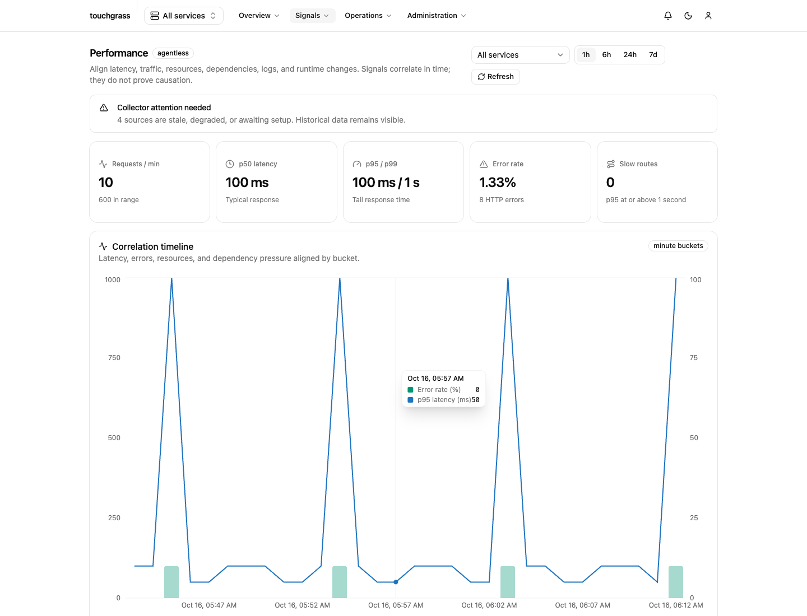
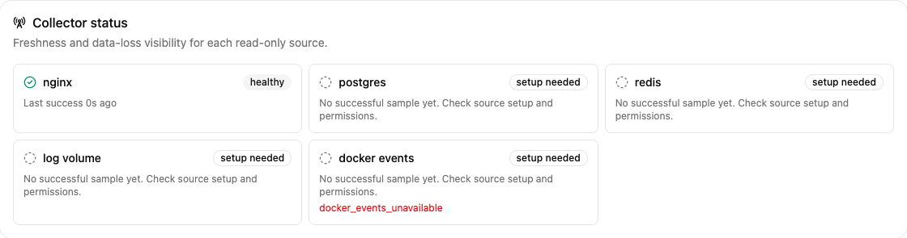

# Agentless performance observability release validation

**Date:** 2026-10-16  
**Branch:** `develop`  
**Reviewed range:** `38c9642..HEAD`  
**Decision:** Ready for a source-by-source rollout, subject to the limitations below. This evidence does not authorize or perform a production deployment.

## What was validated

The review traced the complete path from privacy-safe Nginx JSONL records and native PostgreSQL/Redis/Docker reads through persisted cursors, minute/hour aggregates, authenticated APIs, and the global/service Performance UI. It checked migration idempotency, cursor recovery, histogram math, timeouts, privacy, authorization, bounded queries and ingestion, goroutine shutdown, accessibility, documentation, and rollback behavior.

Four release findings were corrected during this pass:

1. HTTP observations with the same route and status in different minutes could be merged into the last minute. The aggregate key now includes the UTC minute, with a focused regression test.
2. Go's year-one zero-time value could render as `739903d ago`. Collector freshness now normalizes that sentinel to “No successful sample yet.”
3. A large Nginx backlog or oversized line could make one poll allocate unbounded memory. Reads are now limited to 10,000 complete records per poll and lines at or above 64 KiB are dropped visibly without losing the next valid record.
4. Dependency review found an outdated Go patch toolchain and a build-time CLI classified as a runtime dependency. The toolchain is now Go 1.26.9, and `shadcn` is a development dependency.

## Measured overhead and privacy

`./scripts/performance-soak.sh` used a fresh temporary SQLite database, 500 representative Nginx timing records, a baseline process with native collection disabled, and an enabled process with a 100 ms test cadence.

| Measurement | Result | Gate |
|---|---:|---:|
| Baseline / enabled CPU average | 2.85% / 0.69% | informational |
| Calculated collector CPU overhead | 0.00% | under 5% |
| Baseline / enabled RSS | 26,648 / 29,330 KiB | informational |
| RSS growth | 2,682 KiB | at most 32,768 KiB |
| SQLite file growth | 0 bytes | at most 8 MiB |
| SQLite-backed Performance API p95 | 0.69 ms | at most 500 ms |
| Timing observations stored | 500 / 500 | complete |
| Sensitive fixture matches | 0 | zero |

The CPU comparison is a short local process sample, not a capacity forecast; startup work made the baseline sample noisier than the enabled sample. The gate conservatively clamps a negative delta to zero. RSS, storage, API latency, completeness, and privacy checks are independently enforced.

The privacy scan injected an email address, token, and query-string marker through a request path and found none in SQLite or the Touch Grass server log. The Nginx configuration is also rejected if it references request URIs, arguments, headers, remote identities, cookies, or raw request lines. Only allowlisted route families are stored.

## Failure and recovery matrix

| Scenario | Method | Result |
|---|---|---|
| Nginx source disappears | Live process restart with the configured JSONL path absent | Source reported `nginx_unavailable`; all 600 historical requests and their p95/error totals remained queryable. |
| Touch Grass restarts mid-stream | Live process stop/start using the same SQLite DB and timing file | Persisted cursor resumed at 600 without replay; appending 10 records advanced the total to 610. |
| Rotation and truncation | `TestTailerRotationAndTruncationAreVisible` | New file identity and file shrink reset safely and increment visible loss accounting. |
| Malformed and incomplete records | `TestTailerCountsMalformedAndIncompleteRecords` plus oversized-line regressions | Malformed/oversized complete records are counted as dropped; incomplete final records remain unread for retry. |
| Large catch-up backlog | `TestTailerBoundsEachReadBatch` | One poll processes at most 10,000 complete records; the next poll continues from the persisted offset. |
| PostgreSQL/Redis counter reset | `internal/dbstats` delta/reset tests | Reset counters establish a new baseline and never create negative rates. |
| One native source fails | `TestPerformanceCollectorIsolatesSourceFailuresAndPersistsStatus` | Other sources continue, the failed source records a safe category, and history remains available. |
| Container event stream interruption/recreation | container-event cursor, expected-cutover, stream-failure, and cancellation tests | Cursor persists, planned cutovers are classified, stream failures are visible, and retry cannot replay persisted events. |
| Collector shutdown | collector and container-event cancellation tests | Loops stop on context cancellation without leaking work. |
| SQLite budget threshold | maintenance test with a deliberately tiny configured budget | Over-budget state is reported without deleting live data; checkpoint and online-backup tests pass. Physical host-disk exhaustion was not induced. |

The local release environment did not provide live Docker, PostgreSQL, or Redis daemons. Their failure, cursor, reset, and cancellation paths were therefore exercised with deterministic package tests; the Nginx tailer and full Touch Grass process restart were exercised live.

## Browser evidence

The browser session used the embedded production UI against the production-like fixture database. It verified authenticated access, responsive global metrics, route-family-only labels, partial-source messaging, and the corrected zero-time state.





## Verification commands

The following release gates passed:

```text
go test ./internal/nginxlog -count=1
go test ./internal/dbstats -run 'TestPostgres|TestRedis|TestCounterDelta' -count=1
go test ./internal/service -run '<collector, cursor, cancellation, and minute-bucket regressions>' -count=1
go test ./internal/store -run '<migration, cursor, budget, checkpoint, and backup regressions>' -count=1
make vet
make test-race
npm run verify --prefix web
npm test --prefix web
make build
./scripts/performance-soak.sh
PATH="$(go env GOPATH)/bin:$PATH" make audit
npm audit --prefix web --omit=dev --audit-level=high
npm audit --prefix docs-site --omit=dev --audit-level=high
TOUCHGRASS_ADMIN_PASSWORD=compose-validation-only docker compose config
git diff --check
```

`govulncheck` found no actionable standard-library vulnerability after selecting Go 1.26.9. Two Moby client advisories remain explicitly accepted by the existing audit gate because their fixes are daemon-side and no fixed client version is available (`GO-2026-4887`, `GO-2026-4883`). Production npm dependency audits report zero vulnerabilities.

The repository-wide `make all` reaches lint and then stops on 444 findings (down from the 446-finding baseline recorded before this final validation task). A changed-code lint against Task 10's base (`c9f0f7b`) reports zero new findings; vet, race tests, unit tests, both builds, audits, and the soak pass. The lint baseline remains explicit cleanup debt rather than being hidden by this evidence.

## Rollback proof

Each source is independently disabled by unsetting its environment variable and removing only its read-only mount:

- Nginx: `TOUCHGRASS_NGINX_TIMING_LOG`
- PostgreSQL: `TOUCHGRASS_POSTGRES_CONTAINER`
- Redis: `TOUCHGRASS_REDIS_CONTAINER`
- Docker/log collection: remove the corresponding read-only runtime access

Disabling a source stops new samples but does not delete historical aggregates. The live missing-Nginx test above confirmed that dashboards remain usable during rollback. Schema rollback is not required to disable collection; SQLite backup and restore procedures are documented in `docs/database-ops.md`, and the source-by-source rollout/rollback sequence is in `docs/performance-operations.md`.

## Known limitations

- These signals are time-aligned correlations, not distributed traces and not proof of causality. A focused measurement is still required before optimizing application code.
- Native Docker metrics identify a container, not an exact source line or function.
- Performance reads cap each source at 10,000 aggregate rows. Hourly rollups reduce normal cardinality; operators should narrow the range or service filter if an unusually high-cardinality window reaches the cap.
- Live daemon recreation and live PostgreSQL/Redis failure injection were not available in this local environment; deterministic source adapters cover those paths.
- The full web development dependency audit still reports eight high advisories under the build-time `shadcn` CLI chain. The CLI is absent from production-only installs, whose audit is clean.
- Vite still reports the existing approximately 980 KiB main chunk and the parent Expo `tsconfig` warning. Neither was introduced by the performance workspace.
- The repository-wide strict lint baseline is now 444 findings; Task 10's changed code is clean.

## Release conclusion

The agentless Performance workspace preserves privacy, remains useful when individual sources fail, bounds its ingestion and storage work, survives restart without duplicate ingestion, and stays within the measured local overhead gates. Roll out one source at a time and compare the same CPU, RSS, SQLite, loss, and API-latency measurements before enabling the next source.
